

# Calist

**Turns a round of medical-device inspection forms into one equipment register, in seconds.**

Drop in a folder of Excel inspection forms. Calist reads every one and writes `device list.xlsx`:
one row per device, with its manufacturer, model, serial number, location, date and status.

 

<picture>
  <source media="(prefers-color-scheme: dark)" srcset="images/screen-round-dark.png">
  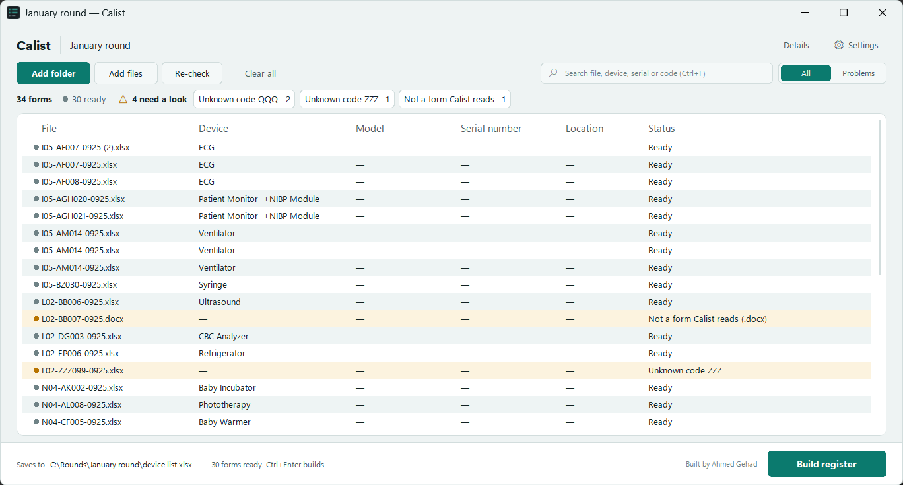
</picture>

 

## Contents

1. [Install Calist](#1-install-calist)
2. [Your first register, in five steps](#2-your-first-register-in-five-steps)
3. [A tour of the window](#3-a-tour-of-the-window)
4. [Name your forms so Calist knows them](#4-name-your-forms-so-calist-knows-them)
5. [What Calist reads from each form](#5-what-calist-reads-from-each-form)
6. [When something needs a look](#6-when-something-needs-a-look)
7. [Reading the register in Excel](#7-reading-the-register-in-excel)
8. [Finding a form quickly](#8-finding-a-form-quickly)
9. [Settings](#9-settings)
10. [Very large rounds: Turbo](#10-very-large-rounds-turbo)
11. [Keyboard shortcuts](#11-keyboard-shortcuts)
12. [Updates](#12-updates)
13. [Questions and fixes](#13-questions-and-fixes)
14. [Privacy](#14-privacy)
15. [Uninstalling](#15-uninstalling)
16. [Help](#16-help)

---

## 1. Install Calist

Calist runs on **Windows 10 or 11** (64-bit). You don't need Python, admin rights or anything else.
The register template is built in, so there is nothing to set up.

**To install:**

1. Open **Calist-setup.exe**.
2. If Windows says *"Windows protected your PC"*, click **More info**, then **Run anyway**. The file
   isn't code-signed, which is why Windows asks; you only see this once.
3. Leave the desktop shortcut ticked if you want one. Calist installs and opens.

You'll find Calist in the Start menu afterwards. It installs into your own user folder, so other
people on the same PC aren't affected. From then on it keeps itself up to date: see
[Updates](#12-updates).

> **If your antivirus blocks the installer**, your IT department can allow it by its checksum. Each
> release lists it in `SHA256SUMS.txt`, and `Get-FileHash .\Calist-setup.exe -Algorithm SHA256` in
> PowerShell gives the one to compare.

---

## 2. Your first register, in five steps

### Step 1 · Add the round's folder

Drag the round's folder onto the window, or click **Add folder** (<kbd>Ctrl</kbd>+<kbd>O</kbd>).
Every Excel form inside comes in, subfolders included. **Add files** picks single forms instead.

<picture>
  <source media="(prefers-color-scheme: dark)" srcset="images/screen-drop-dark.png">
  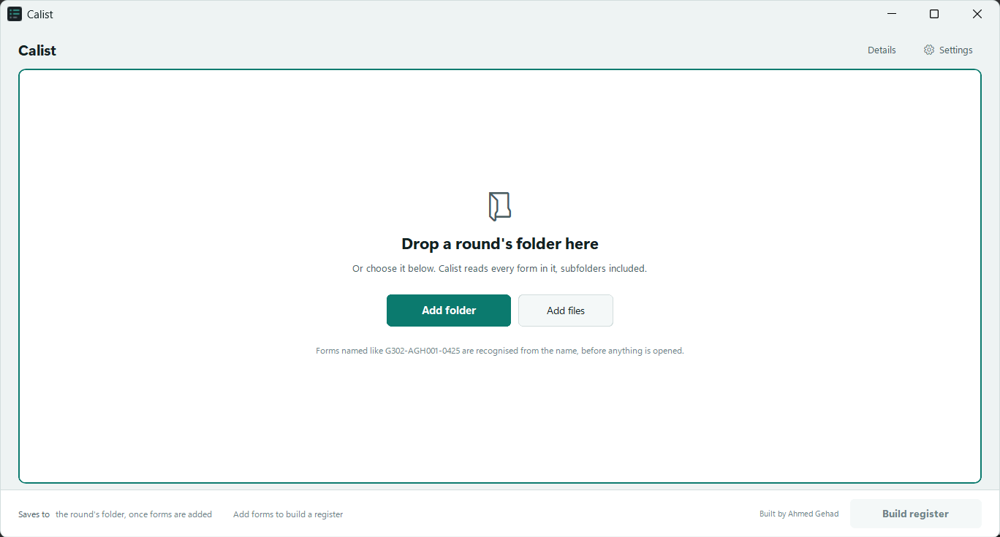
</picture>

### Step 2 · Check the list

Every form gets a row straight away. Calist recognises each one **from its file name**, before
opening anything, so a problem shows up now rather than halfway through.

- A **grey dot** and *Ready*: Calist knows this device and will read the form.
- An **amber dot** and a tinted row: something needs a look (see [section 6](#6-when-something-needs-a-look)).

The line above the table counts the forms, and groups the problems into **chips**.

<picture>
  <source media="(prefers-color-scheme: dark)" srcset="images/screen-round-dark.png">
  
</picture>

### Step 3 · Fix what needs a look (if you want to)

Click a chip to see just those files. Right-click a file and choose **Open the form** to fix it in
Excel, save it, then press **Re-check** (<kbd>F5</kbd>) and Calist reads everything again.

You don't have to fix anything first: forms that can't be used are simply left out of the register,
and listed.

<picture>
  <source media="(prefers-color-scheme: dark)" srcset="images/screen-group-dark.png">
  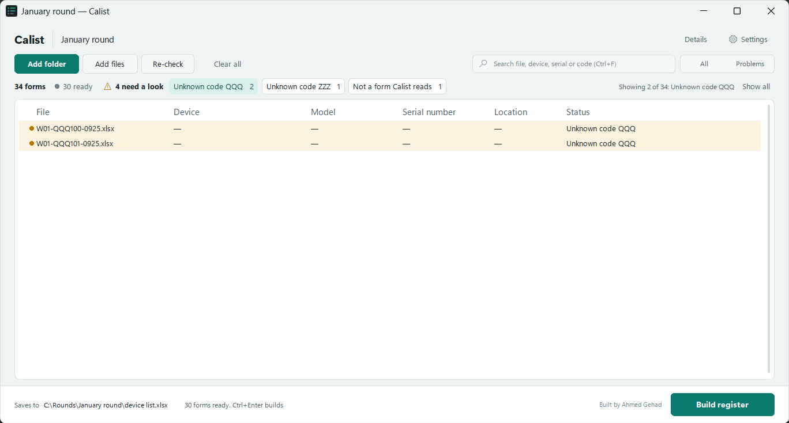
</picture>

### Step 4 · Build the register

Click **Build register** (<kbd>Ctrl</kbd>+<kbd>Enter</kbd>). Each row fills in with its model,
serial number and location as its form is read. The bottom of the window shows which form is open
and about how long is left.

**Cancel** stops cleanly between two forms and writes nothing, so a cancelled build never leaves
half a register behind.

<picture>
  <source media="(prefers-color-scheme: dark)" srcset="images/screen-working-dark.png">
  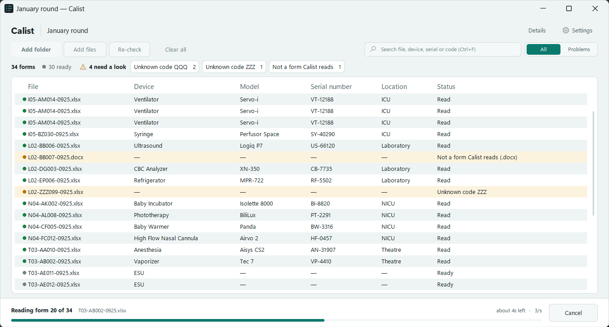
</picture>

### Step 5 · Open the register

When it's done, the bottom of the window says **Register built** and how many rows went in. Click
**Open register** to open it in Excel, or **Show in folder** to see where it is. The table now shows
only what still needs a look.

For a few seconds a card under **Details** (top right) says how many things there are to look at,
or that nothing needs a look. Click it to open Details and see what to do about each one.

<picture>
  <source media="(prefers-color-scheme: dark)" srcset="images/screen-results-dark.png">
  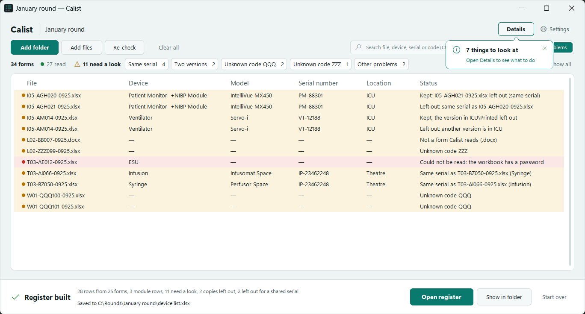
</picture>

The register is called **`device list.xlsx`** and is saved in **the round's folder** (the first
folder you added). The bottom of the window shows the full path before you build, so you always
know where it goes. If a register is already there, it says *(replaces the existing file)*.

**Start over** clears the result and takes you back to the list.

---

## 3. A tour of the window

<picture>
  <source media="(prefers-color-scheme: dark)" srcset="images/tour-dark.png">
  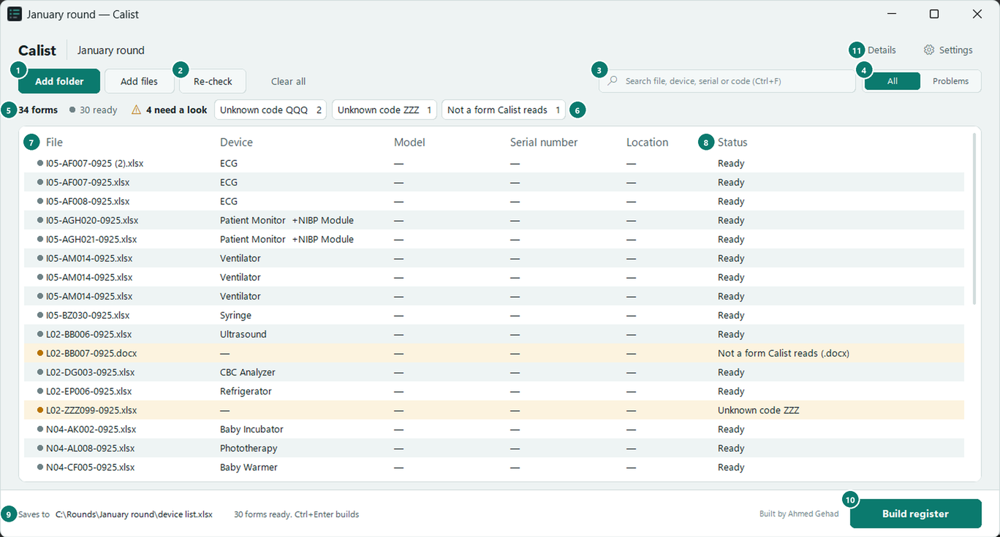
</picture>

| | | |
|:---:|---|---|
| **1** | **Add folder · Add files** | Bring in a round: a whole folder (subfolders included), or single forms. You can also drag a folder onto the window. |
| **2** | **Re-check · Clear all** | **Re-check** reads every folder and file you added again, after you've fixed or renamed forms in Explorer. **Clear all** empties the list: click it, then click *Clear the list?* within three seconds to confirm. |
| **3** | **Search** | Finds forms by file name, device, serial number or code. Several words narrow it down. |
| **4** | **All · Problems** | Show every form, or only the ones that need a look. |
| **5** | **The counts** | How many forms, how many are ready (or read), and how many need a look. |
| **6** | **Problem chips** | Each kind of problem, with how many forms have it. Click one to see just those forms; click it again to see everything. |
| **7** | **The forms** | One row per form: file, device, model, serial number, location. The dot on the left is its state. |
| **8** | **Status** | What happened to the form, in words: *Ready*, *Read*, or the problem and what it is. |
| **9** | **Saves to** | Where the register will be saved. |
| **10** | **Build register** | Reads the forms and writes the register. |
| **11** | **Details · Settings** | **Details** explains everything that needs a look, one entry per problem. **Settings** holds the save folder, two options and the light or dark look. |

**What the dots mean:**

| Dot | Status | Meaning |
|:---:|---|---|
| ⚪ grey | *Ready* | Recognised from its name; it'll be read when you build. |
| 🟢 green | *Read* | Read and in the register. |
| 🟠 amber | *Unknown code …*, *Same serial …*, *Left out: …* | Needs a look. The row is tinted, and the status says why. |
| 🔴 red | *Could not be read: …* | Calist couldn't open the form. The status says why (for example, a password). |
| faint | *Copy, left out* · *Cancelled* | Nothing to do: an identical copy of another form, or a build you cancelled. |

---

## 4. Name your forms so Calist knows them

Calist tells what a form is **from its file name**:

<picture>
  <source media="(prefers-color-scheme: dark)" srcset="images/filename-dark.png">
  
</picture>

| Part | Example | What it is |
|---|---|---|
| **Site code** | `G302` | The hospital or site: a letter, then digits. |
| **Device** | `AGH` | The type of device, which tells Calist how its form is laid out. |
| **Unit** | `001` | Which device of that type, at that site. |
| **Round** | `0425` | The month and year of the visit, as MMYY. |

Calist reads `.xlsx`, `.xlsm` and `.xls` workbooks. It skips Excel's temporary `~$` files, and its
own earlier `device list.xlsx`, by itself.

**Typing slips are fine.** Calist tidies the name it writes into the register (the *Code* column)
and **never renames your files**:

| The file is called | The register says |
|---|---|
| `w01-ac004-0326` | `W01-AC004-0326` |
| `W01-AC004 -0326 ` | `W01-AC004-0326` |
| `Copy of W01-AC004-0326` | `W01-AC004-0326` · marked, so you can find the real file |
| `WO1-AC004-0326` (a letter O) | `W01-AC004-0326` · marked |
| `W01-AC004-0326 (2)` | `W01-AC004-0326` · marked |
| `W01-AC004-1326` (there is no month 13) | the month and year from the form's own date · marked |

A name without a device code can't be recognised. Rename the file, or it will show as a problem.

---

## 5. What Calist reads from each form

Calist knows where each device's form keeps its details, and copies them into one row. Here is a
patient monitor's form, and the two rows it becomes:

<picture>
  <source media="(prefers-color-scheme: dark)" srcset="images/form-to-row-dark.png">
  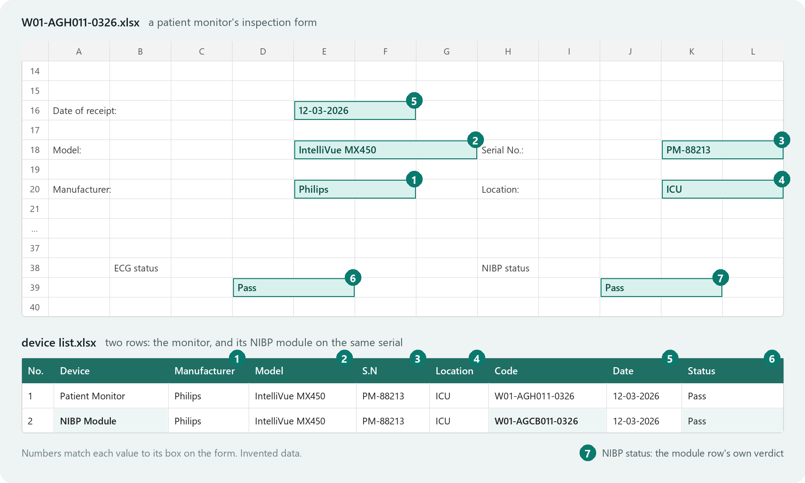
</picture>

The register's columns are **No., Device, Manufacturer, Model, S.N, Location, Code, Date and
Status**.

Some devices are inspected as one unit but recorded as two: a patient monitor and its blood-pressure
(**NIBP**) module share a serial, but each has its own result, so the register gets a second row,
*NIBP Module*, right under the monitor. The table shows this as **+NIBP Module** beside the device.

If a form was re-laid-out, or an engineer filled in a different tab, Calist still finds the details
by the form's own printed labels.

---

## 6. When something needs a look

Every problem is shown in the table, counted in a chip, and explained in **Details**. What each one
means, and what to do:

| You see | What it means | What to do |
|---|---|---|
| **Unknown code QQQ** | No device type in Calist uses the code in this file's name. | Check the file name for a typo. If it's a new kind of device, ask for it to be added (see [Help](#16-help)). |
| **Not a form Calist reads** (`.docx`, `.pdf`, …) | The file isn't an Excel workbook. | Nothing: it's left out. |
| **Could not be read: …** | Calist couldn't open the workbook, for example because it has a password. | Do what it says (remove the password in Excel), then build again. |
| **Same serial** | Two forms of the same visit give the same serial number. | Usually one form has the wrong serial: open both, correct the wrong one, build again. |
| **Two versions** | The same form is saved in two folders, with different contents. | Keep the right one, move or delete the other, then build again. |
| **Copy, left out** | An identical copy of a form already in the round (for example `… (2).xlsx`). | Nothing: the register has it once. |
| **Left out: same serial as …** | With *Remove duplicate serial numbers* on: a later form of the same device and visit gives the same serial, so only the first is written. | Check it really is the same device. The kept row's serial names the file that was left out. |
| **Left out: another version is in …** | With *Remove duplicate serial numbers* on: the same form is saved in two folders, and only one is written. | Keep the right one, move or delete the other, then build again. |

Device lists, blank templates and files named without a site code are never read: they don't
appear in the table at all, and **Details** lists each one, with the reason it was left out.

**Same serial**, picked as a chip, groups the forms under the serial they share, with each one's
model and location, so you can tell a copied form from one device numbered twice:

<picture>
  <source media="(prefers-color-scheme: dark)" srcset="images/screen-shared-dark.png">
  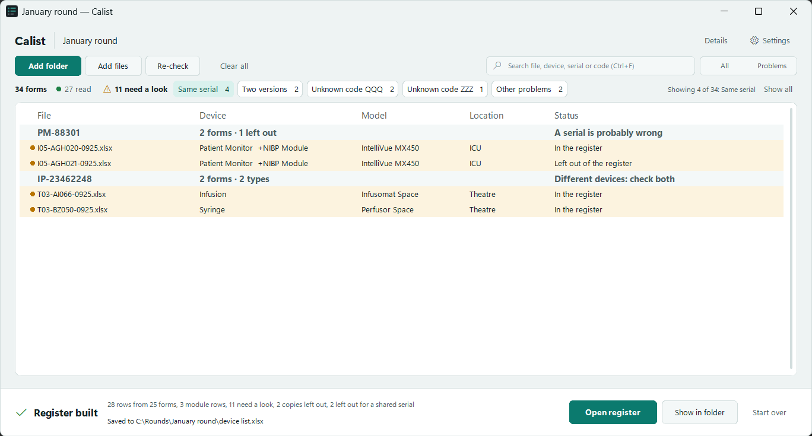
</picture>

**Details** (top right) opens a list under the table that tells the whole round in plain words:
each problem, which files it involves, and what to do. Double-click an entry to show its files in
the table; right-click it to open the forms or the register.

<picture>
  <source media="(prefers-color-scheme: dark)" srcset="images/screen-details-dark.png">
  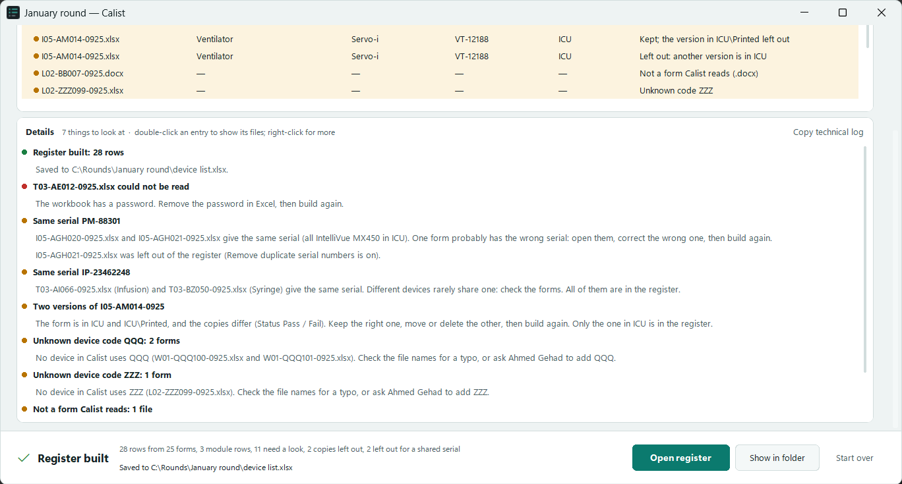
</picture>

---

## 7. Reading the register in Excel

Calist never quietly drops a value. When it keeps something it isn't sure about, the cell is filled
**amber** and carries an Excel note, signed *Calist:*, saying why. Point at the cell (or its little
red corner) to read it.

<picture>
  <source media="(prefers-color-scheme: dark)" srcset="images/notes-dark.png">
  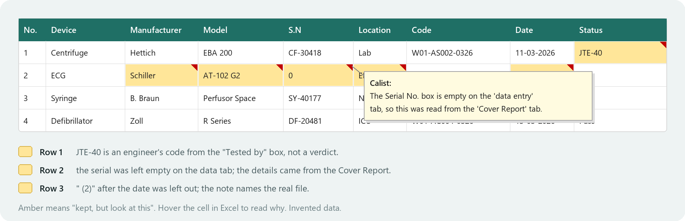
</picture>

Notes you may see:

| The note says | What it means |
|---|---|
| *Missing.* | The form left the box empty, or put a `0` in it. (`N.A` is an answer, so it isn't marked.) |
| *The Serial No. box is empty on the 'data entry' tab, so this was read from the 'Cover Report' tab.* | The value came from another tab of the same form. |
| *Read by finding the form's printed labels; …* | The form's layout has changed, so the values were found by their captions. They're usually right; give them a look. |
| *Not a verdict — …* | The status box held something that isn't a result, like an engineer's code or a reading. |
| *Does not look like a serial number …* | Exactly that: check the form. |
| *… has the same serial …* | Another form of the visit gives the same serial; the note names the file. |
| *The same form in … says …* | The form is saved twice with different values; the note says what the other copy says. |

A few more things to know:

- **Statuses are written one way**: *Pass*, *Fail*, *Limited non*, *Limited Fail* and *Calibrated*,
  so `PASS`, `pass.` or `Passs` all become *Pass*. *Fail* and *Limited Fail* are in **bold**.
- **A device with two serial numbers** (an ultrasound and its probe, an X-ray and its tube) shows
  both, on two lines of the same cell.
- **Rows are in order**, and a module row always sits right under its device.
- **The register is signed**: a line under the last row says it was generated by Calist, by whom
  and when.

---

## 8. Finding a form quickly

**Search** (<kbd>Ctrl</kbd>+<kbd>F</kbd>) looks through file names, devices, serial numbers and
codes as you type. Several words narrow it down: `I05 monitor` finds the patient monitors of site I05.

<picture>
  <source media="(prefers-color-scheme: dark)" srcset="images/screen-search-dark.png">
  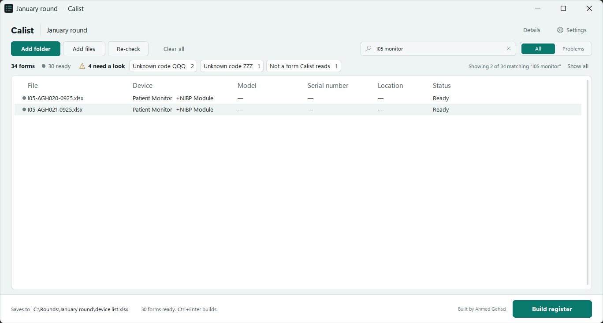
</picture>

On any form in the table:

| Do this | To |
|---|---|
| **Right-click** | *Open the form* in Excel, *Show in folder*, *Copy file name*, or *Remove from the list* |
| **Double-click** | Show the file in Explorer |
| <kbd>Delete</kbd> | Take the selected forms off the list (the files themselves are not touched) |

**Show all** (at the right of the counts line) clears any chip, filter or search.

---

## 9. Settings

Click **Settings** (top right, or <kbd>Ctrl</kbd>+<kbd>,</kbd>).

<picture>
  <source media="(prefers-color-scheme: dark)" srcset="images/screen-settings-dark.png">
  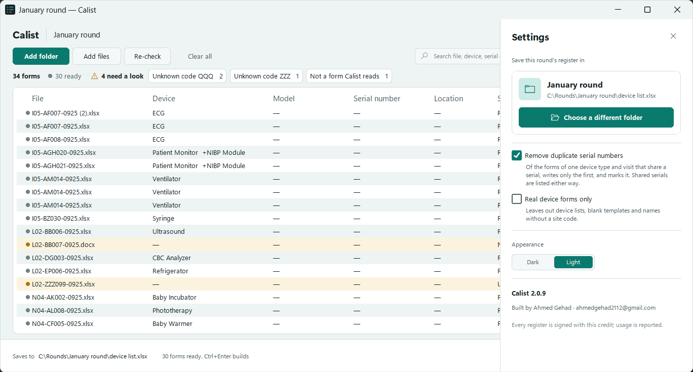
</picture>

| Setting | What it does |
|---|---|
| **Update now** | Only while a new version is ready, at the top. Installs it now: Calist closes for about 20 seconds and opens again with your forms. |
| **Save this round's register in** | A card shows the folder the register is saved in, with its full path, and says so if a register already there will be replaced. Click **Choose a different folder** to save this round's register somewhere else. It's for **this round only**: the next round goes back to its own folder. *Use the round's folder* undoes it. |
| **Remove duplicate serial numbers** | Off by default. When two forms of one device type and visit share a serial, it writes only the first and marks it. Shared serials are listed either way. |
| **Appearance** | Dark or Light. |
| **About** | Your Calist version, and whether it's up to date. |

Calist remembers your settings between sessions (all except the save folder, which is for one round).

---

## 10. Very large rounds: Turbo

From **1,000 forms** up, Calist switches to **Turbo** by itself. It lists only the forms that need a
look, so the window stays quick even on an archive of tens of thousands of forms. A lightning bolt
shows it's on.

<picture>
  <source media="(prefers-color-scheme: dark)" srcset="images/screen-turbo-dark.png">
  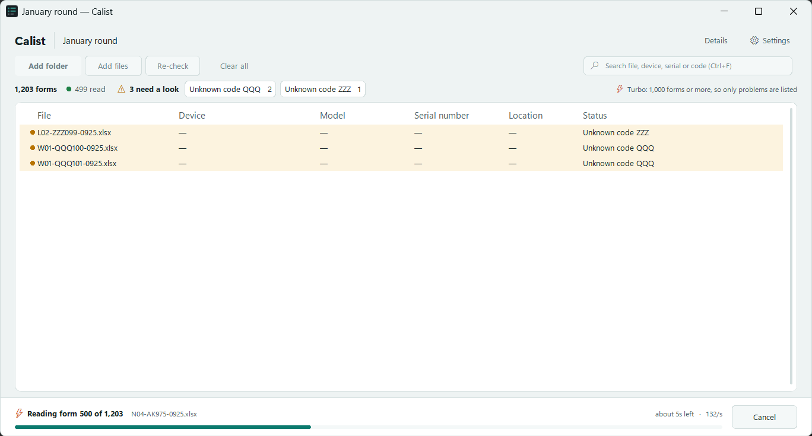
</picture>

---

## 11. Keyboard shortcuts

| Keys | What it does |
|---|---|
| <kbd>Ctrl</kbd>+<kbd>O</kbd> | Add a folder |
| <kbd>Ctrl</kbd>+<kbd>F</kbd> | Search the forms |
| <kbd>F5</kbd> | Re-check every folder and file again |
| <kbd>Ctrl</kbd>+<kbd>Enter</kbd> | Build the register, or open it once it's built |
| <kbd>Ctrl</kbd>+<kbd>,</kbd> | Settings |
| <kbd>Esc</kbd> | Back out one step: the update question (Later), the card under Details after a build, then Settings, then a filter or search, then a running build |
| <kbd>Delete</kbd> | Take the selected forms off the list |
| <kbd>Tab</kbd>, <kbd>Enter</kbd>, <kbd>Space</kbd> | Reach and press every button from the keyboard |

---

## 12. Updates

**Calist updates itself. There is nothing to download, and you never have to press anything — but
when an update is ready, Calist tells you, and you can install it at once.**

- When a new version is out, Calist fetches it in the background and checks it. Never while a
  register is being built.
- About a minute after Calist opens, it asks. **Update now** installs it straight away: Calist
  closes for about 20 seconds and opens again with the forms you added. **Later** leaves it for
  when you close Calist. While an update waits, **Settings** shows **Update now** at the top too.
- If you don't press anything, it installs **when you close Calist**, without a window, so the next
  time you open it, it's the new version.
- If the PC was switched off with Calist open, the update installs the next time you start it,
  before the window opens.
- After an update, Calist says **"Calist was updated to …"**, once.
- An update can't leave you without a working Calist: if anything goes wrong, the version you had
  simply opens, says why, and offers **Try again**.

<picture>
  <source media="(prefers-color-scheme: dark)" srcset="images/screen-update-dark.png">
  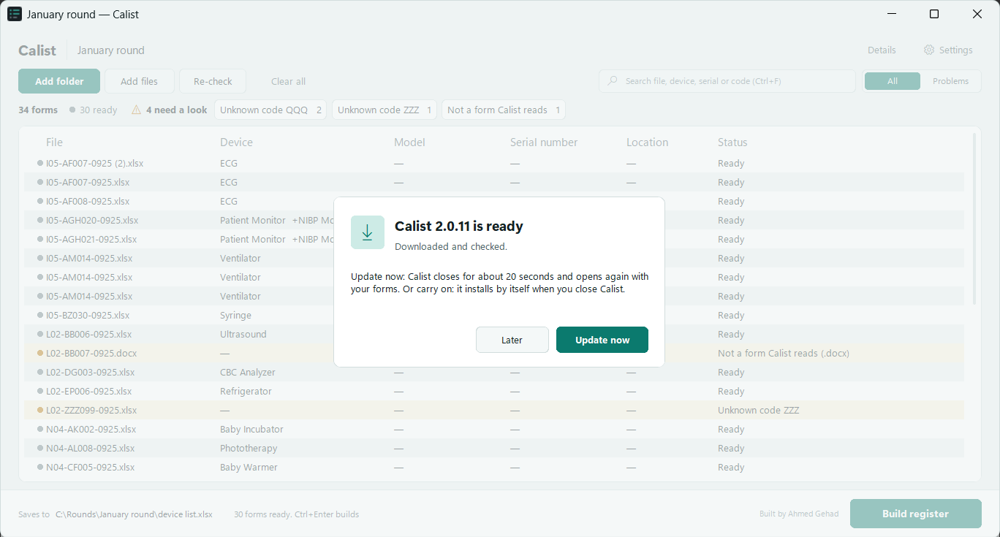
</picture>

To see which version you have and whether it's up to date, open **Settings**: it's under About.

---

## 13. Questions and fixes

<b>Windows says "Windows protected your PC"</b>

 
Click <b>More info</b>, then <b>Run anyway</b>. Windows asks because the installer isn't code-signed.
You only see it the first time.

<b>My antivirus blocks the installer</b>

 
Ask your IT department to allow <code>Calist-setup.exe</code> by its SHA-256 checksum, which each
release lists in <code>SHA256SUMS.txt</code>. If it's Windows Defender, the false positive can also
be reported to Microsoft through
<a href="https://www.microsoft.com/en-us/wdsi/filesubmission">their submission form</a>.

<b>A form says "Unknown code", but the name looks right</b>

 
The code is the letters after the first dash (<code>AGH</code> in <code>G302-AGH001-0425</code>).
If those are right and it's a kind of device Calist doesn't know yet, ask for it to be added
(see <a href="#16-help">Help</a>).

<b>I fixed some forms. Do I have to start again?</b>

 
No. Press <b>Re-check</b> (<kbd>F5</kbd>): Calist reads every folder and file you added again,
renamed and deleted files included. Then build.

<b>The register didn't save</b>

 
If an earlier <code>device list.xlsx</code> is open in Excel, Windows won't let Calist replace it.
Close it in Excel and build again. The bottom of the window, and Details, say what happened.

<b>Where did my register go?</b>

 
Into the first folder you added, as <code>device list.xlsx</code>, unless you chose another folder in
Settings for this round. After a build, <b>Show in folder</b> opens it in Explorer.

<b>Dropping a folder on the window does nothing</b>

 
On a few PCs drag-and-drop isn't available. Use <b>Add folder</b> (<kbd>Ctrl</kbd>+<kbd>O</kbd>) instead;
it does exactly the same.

<b>Does Calist change my forms?</b>

 
No. Calist only reads the forms; it never edits, moves or renames them. The one file it writes is the
register.

---

## 14. Privacy

Calist keeps a small usage log for its developer, in a private Google Sheet, so a problem on
someone's PC can be seen and fixed without asking them to go digging. It sends one line each time
you build a register, when Calist starts, and if Calist hits an error:

- **What's in it:** counts and timings (how many forms and rows, how long it took), where the
  register was saved, error messages with folder names removed, device codes Calist didn't
  recognise, the Calist version, your PC's processor count and memory, your Windows user name and
  PC name, and a random number Calist makes for this PC.
- **What's never in it:** anything from inside a form (no serials, models, sites or readings), and no
  file names.
- **It never slows you down:** nothing is sent while a register is being built or a folder is being
  read.

Calist also connects to github.com, where its updates come from. Nothing of yours is sent there.

---

## 15. Uninstalling

Open Windows **Settings → Apps**, find **Calist**, and choose **Uninstall**, as with any program.
Your settings are kept, in case you install it again.

---

## 16. Help

Questions, a device type to add, or a form Calist reads wrongly:
**Ahmed Gehad · [ahmedgehad2112@gmail.com](mailto:ahmedgehad2112@gmail.com)**

If it's about a particular round, open **Details** and click **Copy technical log**, then paste it
into your email: it tells exactly what Calist did.

 

Copyright © 2026 Ahmed Gehad. All rights reserved. Every screenshot on this page uses invented data.

